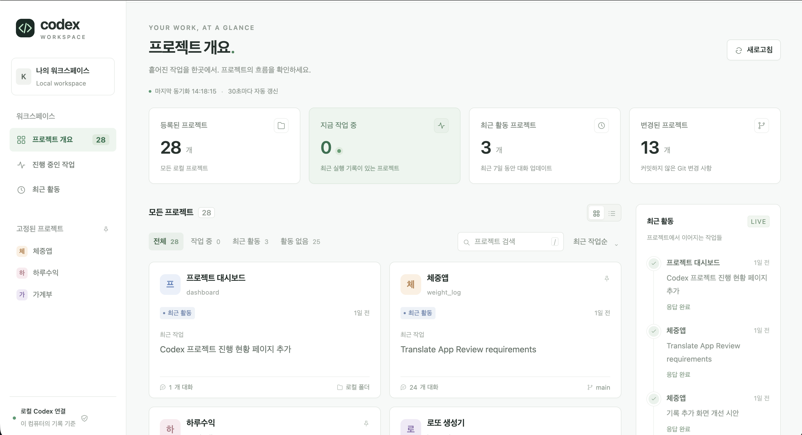

# 🧭 AI로 만든 프로젝트 관리 대시보드

!!! note ""
    여러 개의 개인 프로젝트를 AI 코딩 도구(Codex · Claude)와 함께 동시에 진행하다 보니, 어떤 프로젝트에서 무슨 작업을 하고 있었는지 한눈에 보기 어려웠습니다. 그래서 **로컬의 모든 프로젝트를 한곳에서 관리하는 대시보드**를 AI로 직접 만들어 매일 사용하고 있습니다.

    **관리 중인 프로젝트 28개** · 일정시간마다 자동 갱신 · 로컬 실행

## 왜 만들었나

- 앱·게임·웹·서버 등 프로젝트가 늘어나면서 **작업 흐름이 여러 폴더와 AI 대화 기록에 흩어짐**
- 어느 프로젝트에 커밋하지 않은 변경이 남아 있는지, 마지막으로 AI에게 무엇을 요청했는지 일일이 확인해야 했음
- 이 문제를 **AI에게 설명하고 기획·디자인·구현까지 함께 진행**해 개인용 관리 도구로 완성

## 프로젝트 개요 화면

전체 프로젝트 현황과 최근 활동을 한 화면에서 확인

{ .shot }

| 영역 | 내용 |
|---|---|
| 요약 카드 | 등록된 프로젝트, 지금 작업 중, 최근 7일 활동, 커밋하지 않은 Git 변경이 있는 프로젝트 수 |
| 프로젝트 목록 | 카드·리스트 보기 전환, 상태별 필터(전체·작업 중·최근 활동·활동 없음), 검색, 최근 작업순 정렬 |
| 프로젝트 카드 | 최근 작업 제목, 마지막 활동 시점, 대화 수, 브랜치 정보 |
| 최근 활동 피드 | 프로젝트별로 이어지는 AI 작업과 응답 상태를 실시간(LIVE)으로 표시 |
| 고정된 프로젝트 | 자주 보는 프로젝트를 사이드바에 고정해 바로 이동 |

## 프로젝트 상세 화면

프로젝트를 누르면 대화 이력과 Git 상태를 함께 확인

| 영역 | 내용 |
|---|---|
| 활동 지표 | 전체 대화 수, 최근 7일 대화 수, Git 변경 항목 수 |
| Git 상태 | 현재 브랜치와 최근 커밋 여부 |
| 최근 대화 이력 | 프로젝트에서 AI와 나눈 최근 대화(최대 12개)와 응답 완료·대기 상태 |
| 빠른 이동 | 프로젝트 위치 복사로 바로 작업 재개 |

## 어떻게 만들었나

| 단계 | AI 활용 방식 |
|---|---|
| 기획 | 필요한 정보(프로젝트 목록, 대화 기록, Git 상태)와 화면 구성을 AI와 대화로 정리 |
| 디자인 | 카드형 대시보드, 요약 지표, 활동 피드 레이아웃을 AI가 제안하고 반복 수정 |
| 구현 | 로컬 Codex 작업 기록과 Git 상태를 읽어 프로젝트별로 집계하는 기능을 AI 코딩 도구로 구현 |
| 개선 | 실제로 쓰면서 필요한 기능(필터, 고정, 자동 갱신, 상세 모달)을 AI에게 요청해 계속 추가 |

## 써 보니 좋은 점

- 아침에 대시보드만 열면 **어제 어디까지 했는지** 바로 파악
- 커밋하지 않은 변경이 있는 프로젝트를 놓치지 않음
- 응답이 끝나지 않았거나 확인하지 않은 AI 작업을 쉽게 찾아 이어서 진행
- 개인 프로젝트 28개를 혼자서도 꾸준히 관리하는 기반이 됨
