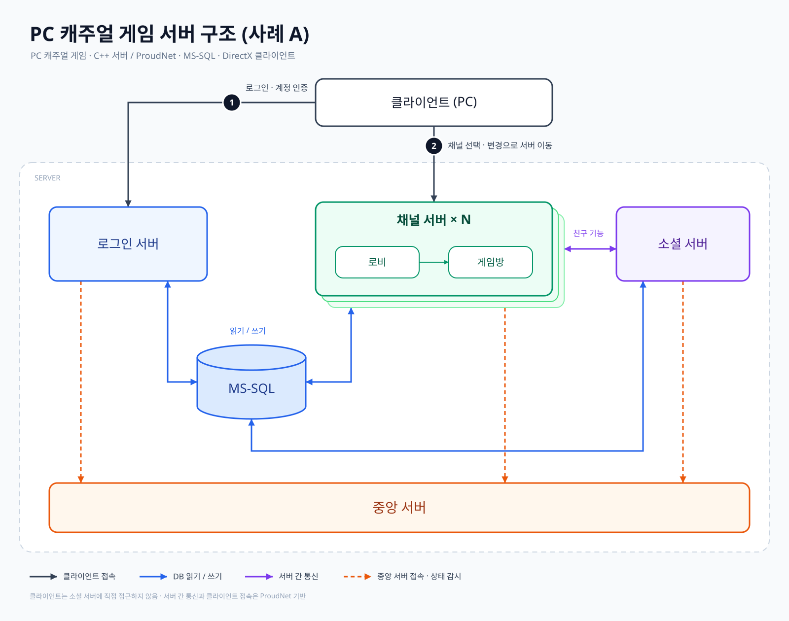

# 🎲 PC 캐주얼 게임 서버 구조 (사례 A)

!!! info ""
    실제 서비스 구조를 바탕으로 일반화해 다시 구성한 구조입니다. 게임명과 사내 고유 명칭은 밝히지 않았습니다.

!!! note ""
    PC 캐주얼 게임의 서버 구조입니다. 채널 선택 후 로비에서 게임을 선택해 들어가는 채널형 구조입니다.

## 서버 전체 구조

{ .diagram }

## 서버별 역할

| 구성 요소 | 대수 | 역할 |
|---|---|---|
| 로그인 서버 | 1대 | 계정 인증. MS-SQL 읽기/쓰기 |
| 채널 서버 | N대 | 로비에서 게임 선택 후 게임방 입장. 게임방은 4인, 슈퍼피어 P2P 방식. MS-SQL 읽기/쓰기 |
| 소셜 서버 | 1대 | 친구 기능 전담. MS-SQL 읽기/쓰기. 클라이언트가 직접 접속하지 않고 채널 서버를 통해 이용 |
| 중앙 서버 | 1대 | 모든 서버가 접속하며, 각 서버의 작동 상태를 확인. 필요에 따른 브로드캐스팅 |
| MS-SQL | 1대 | 계정 및 게임 데이터 저장. 로그인 · 채널 · 소셜 서버가 읽기/쓰기 |

## 접속 흐름

1. 클라이언트가 로그인 서버에 접속해 계정 인증
2. 채널을 선택해 해당 채널 서버로 이동 (채널 변경 시 다른 채널 서버로 이동)
3. 로비에서 게임을 선택해 게임방 입장
4. 게임방은 4인으로 진행하며, 슈퍼피어 방식의 P2P 통신 사용
5. 친구 기능은 채널 서버가 소셜 서버와 통신해 처리

## 설계 포인트

| 포인트 | 내용 |
|---|---|
| 역할별 서버 분리 | 계정 인증(로그인), 로비·게임방(채널), 친구 기능(소셜), 상태 확인(중앙)을 서로 다른 서버로 나눠 각 서버가 한 가지 역할에 집중하도록 구성 |
| 채널 단위 확장 | 채널 서버를 여러 대 두고 클라이언트가 채널 선택·변경으로 서버를 옮겨 다니는 구조로, 접속을 채널 단위로 나눠 받고 필요하면 채널 서버를 늘려 대응 |
| 슈퍼피어 P2P | 4인 게임방의 실시간 통신은 반응성을 위해 슈퍼피어를 중심으로 한 P2P로 처리 |
| 소셜 서버 비공개 | 클라이언트는 소셜 서버에 직접 접속하지 않고 채널 서버를 통해 친구 기능을 이용해, 외부에 노출되는 접속 지점을 로그인 · 채널 서버로 한정 |
| 중앙 서버 상태 확인 | 모든 서버가 중앙 서버에 접속해, 한 곳에서 전체 서버의 작동 여부를 확인할 수 있도록 구성 |
