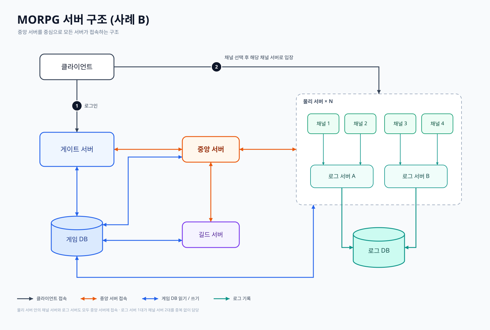

# ⚔️ MORPG 서버 구조 (사례 B)

!!! info ""
    실제 서비스 구조를 바탕으로 일반화해 다시 구성한 구조입니다. 게임명과 사내 고유 명칭은 밝히지 않았습니다.

!!! note ""
    PC MORPG의 서버 구조입니다. 중앙 서버를 중심으로 모든 서버가 접속하고, 게이트 서버에서 로그인한 뒤 채널 서버를 선택해 입장하는 채널형 구조입니다.

## 서버 전체 구조

{ .diagram }

## 서버별 역할

| 구성 요소 | 대수 | 역할 |
|---|---|---|
| 게이트 서버 | 1대 | 로그인 처리. 게임 DB 읽기/쓰기 |
| 채널 서버 | 물리 서버당 4대 | 게이트 서버에서 로그인한 클라이언트가 선택해 입장하는 서버. 게임 DB 읽기/쓰기 |
| 로그 서버 | 물리 서버당 2대 | 1대가 채널 서버 2대씩 중복 없이 담당해 로그 DB에 로그 기록 |
| 중앙 서버 | 1대 | 모든 서버가 접속하는 중심 서버. 전체 서버 접속 관리와 친구, 메일, 경매장 기능 처리. 게임 DB 읽기/쓰기 |
| 길드 서버 | 1대 | 길드 기능 처리. 게임 DB 읽기/쓰기 |
| 게임 DB | - | 게임 데이터 저장. 중앙 · 게이트 · 채널 · 길드 서버가 읽기/쓰기 |
| 로그 DB | - | 로그 서버가 남기는 로그 데이터 저장 |

## 접속 흐름

1. 클라이언트가 게이트 서버에 접속해 로그인
2. 입장할 채널 서버를 선택
3. 선택한 채널 서버로 클라이언트가 입장
4. 채널 서버에서 발생한 로그는 담당 로그 서버가 로그 DB에 기록
5. 친구, 메일, 경매장 기능은 중앙 서버가 처리

## 설계 포인트

| 포인트 | 내용 |
|---|---|
| 중앙 서버 중심 구조 | 모든 서버가 중앙 서버에 접속해, 한 곳에서 전체 서버의 접속을 관리하고 친구 · 메일 · 경매장처럼 서버를 가로지르는 기능을 처리 |
| 물리 서버 단위 구성 | 물리 서버 1대에 채널 서버 4대와 로그 서버 2대를 묶어 두고, 물리 서버를 늘려 채널을 확장 |
| 로그 처리 분리 | 로그 서버 1대가 채널 서버 2대를 중복 없이 담당해, 로그 기록을 채널 서버에서 분리하고 별도의 로그 DB에 저장 |
| 게임 DB와 로그 DB 분리 | 게임 데이터와 로그 데이터를 서로 다른 데이터베이스에 저장 |
| 길드 서버 분리 | 길드 기능을 별도 서버로 나눠 처리 |
