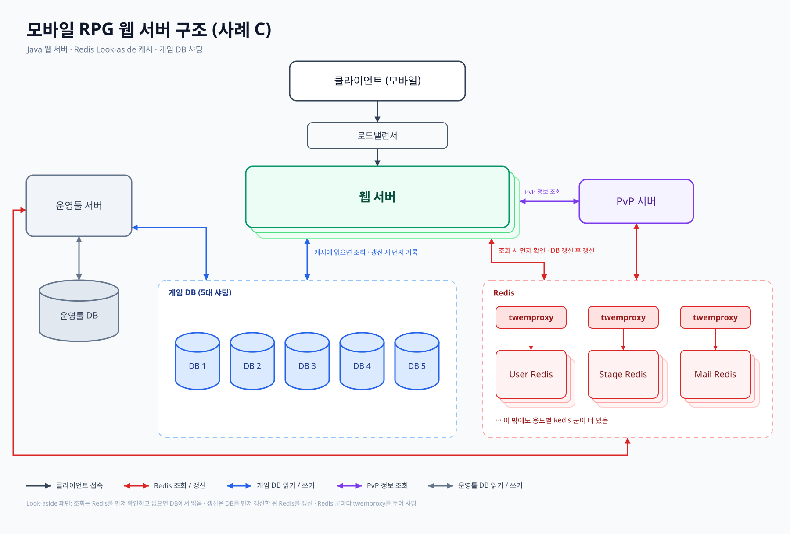

# 📱 모바일 RPG 웹 서버 구조 (사례 C)

!!! info ""
    실제 서비스 구조를 바탕으로 일반화해 다시 구성한 구조입니다. 게임명과 사내 고유 명칭은 밝히지 않았습니다.

!!! note ""
    모바일 RPG · Java 웹 서버 · Look-aside 캐시 · 게임 DB 5대 샤딩

## 서버 전체 구조

{ .diagram }

## 서버별 역할

| 구성 요소 | 대수 | 역할 |
|---|---|---|
| 로드밸런서 | 1 | 클라이언트 요청을 웹 서버들에 분산 |
| 웹 서버 | 20~40대 | Java 기반으로 로그인과 게임 요청을 처리. Redis와 게임 DB를 Look-aside 방식으로 사용하고, PvP 정보는 PvP 서버에서 조회 |
| PvP 서버 | 1대 | PvP 관련 처리 전담. 웹 서버에 PvP 정보를 제공하며 Redis에 접근 |
| Redis 군 | 용도별 다수 | User, Stage, Mail 등 용도별로 군을 나누고, 군마다 twemproxy를 두어 여러 Redis에 샤딩 |
| 게임 DB | 5대 | 게임 데이터를 5대에 샤딩해 저장 |
| 운영툴 서버 | 1 | 운영 업무 처리. 운영툴 DB와 함께 Redis·게임 DB에도 접근 |
| 운영툴 DB | 1 | 운영툴 전용 데이터 저장 |

## 설계 포인트

| 포인트 | 내용 |
|---|---|
| Look-aside 캐시 | 조회는 Redis 우선, 갱신은 DB 후 Redis 순서로 처리해 DB 부하를 줄임 |
| 용도별 Redis 군 | 데이터 성격별로 Redis 군을 분리하고 군마다 twemproxy로 샤딩해 독립적으로 확장 |
| 게임 DB 샤딩 | 게임 DB를 5대로 나눠 쓰기 부하를 분산 |
| 웹 서버 수평 확장 | 상태 없는 웹 서버를 로드밸런서 뒤에 20~40대 운영 |
| PvP 분리 | PvP 처리를 별도 서버로 분리해 웹 서버 로직과 독립적으로 운영 |
| 운영툴 분리 | 운영툴 서버와 DB를 게임 서비스와 분리해 운영 작업이 서비스에 영향을 주지 않도록 함 |
