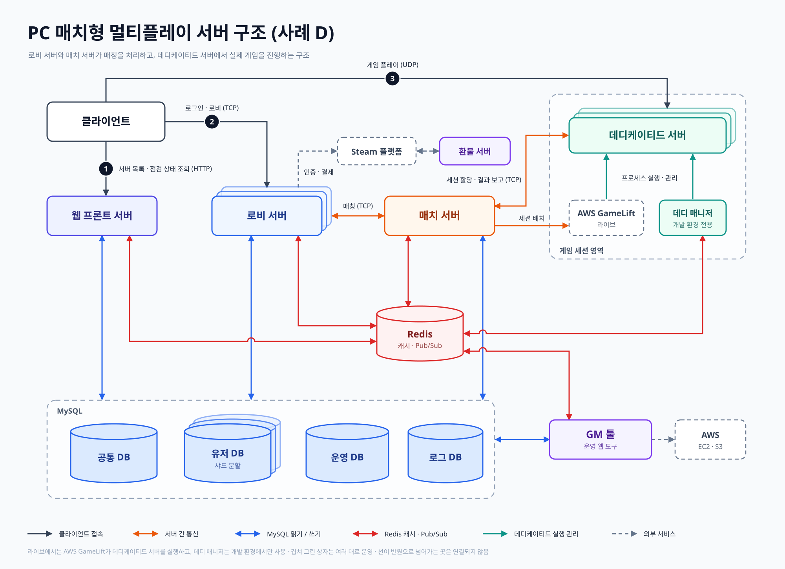

# 🎯 PC 매치형 멀티플레이 서버 구조 (사례 D)

!!! info ""
    실제 서비스 구조를 바탕으로 일반화해 다시 구성한 구조입니다. 게임명과 사내 고유 명칭은 밝히지 않았습니다.

!!! note ""
    PC(Steam) 매치형 멀티플레이 게임의 서버 구조입니다. 로비 서버와 매치 서버가 로그인과 매칭을 처리하고, 매칭이 끝나면 데디케이티드 서버에서 실제 게임을 진행하는 세션형 구조입니다.

## 서버 전체 구조

{ .diagram }

## 서버별 역할

| 구성 요소 | 대수 | 역할 |
|---|---|---|
| 웹 프론트 서버 | - | 클라이언트에 접속할 서버 목록과 점검 상태를 알려줌 (HTTP). 운영 DB와 Redis 사용 |
| 로비 서버 | 여러 대 | 로그인, 인벤토리, 상점, 파티, 배틀패스 등 로비 기능 처리 (TCP). 공통 · 유저 DB 읽기/쓰기, Steam 인증 · 결제 연동 |
| 매치 서버 | 1대 | 로비 서버와 연결되어 매칭을 처리하고, 데디케이티드 서버를 할당한 뒤 게임 결과를 수집. 공통 · 유저 DB 읽기/쓰기 |
| 데디케이티드 서버 | 여러 대 | 실제 게임 플레이 진행. 매치 서버에 등록하고 게임 결과를 보고 |
| AWS GameLift | - | 라이브 환경에서 데디케이티드 서버를 실행하고 게임 세션을 배치. 배치 결과는 SQS 이벤트로 매치 서버에 전달 |
| 데디 매니저 | 1대 | 개발 환경에서만 사용. 데디케이티드 서버 프로세스를 실행하고 관리하며, Redis로 명령을 받음 (라이브 미사용) |
| GM 툴 | - | 유저 조회 · 제재, 공지, 쿠폰, 점검 예약 등을 처리하는 운영 웹 도구. DB 4종 전체를 읽고 쓰며, Redis Pub/Sub으로 서버에 명령 전달 |
| 환불 서버 | - | Steam의 환불 가능 여부 조회 요청에 응답 |
| Redis | - | 서버 정보 · 유저 세션 캐시와 서버 간 Pub/Sub 메시지 전달 |
| 공통 DB | - | 전체 유저가 공유하는 계정 · 공통 데이터 저장 |
| 유저 DB | 샤드별 | 유저별 게임 데이터 저장. 샤드 단위로 나누어 운영 |
| 운영 DB | - | 서버 목록, 점검, 공지 등 운영 데이터 저장 |
| 로그 DB | - | 운영 로그 저장. GM 툴에서 조회 |

## 접속 흐름

1. 클라이언트가 웹 프론트 서버에서 서버 목록과 점검 상태를 조회
2. 안내받은 로비 서버에 접속해 로그인 (Steam 인증)
3. 매칭을 요청하면 로비 서버가 매치 서버에 전달
4. 매치 서버가 데디케이티드 서버를 할당 (라이브는 AWS GameLift, 개발은 데디 매니저)
5. 클라이언트가 할당된 데디케이티드 서버에 접속해 게임 진행
6. 게임이 끝나면 데디케이티드 서버가 매치 서버에 결과를 보고하고, 로비 서버를 거쳐 유저 데이터에 반영

## 설계 포인트

| 포인트 | 내용 |
|---|---|
| 로비와 매칭 분리 | 로비 기능은 여러 대의 로비 서버로 나누고, 매칭과 세션 할당은 매치 서버 한 곳에서 처리 |
| 환경별 데디케이티드 실행 | 라이브는 AWS GameLift로 데디케이티드 서버를 배치하고, 개발 환경은 데디 매니저로 직접 실행해 같은 구조를 비용 없이 테스트 |
| Redis 기반 서버 연동 | 서버 정보와 유저 세션을 Redis에 캐시하고, GM 툴 명령과 서버 간 알림은 Redis Pub/Sub으로 전달 |
| 용도별 DB 분리 | 공통 · 유저 · 운영 · 로그 DB를 나누고, 유저 DB는 샤드 단위로 분할 |
| 서버 목록 진입점 | 웹 프론트 서버가 클라이언트 버전과 점검 상태에 맞춰 접속할 서버를 안내 |
