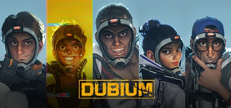

# 🕵️ Dubium

{ .cover }

!!! note ""
    근미래 SF 배경의 소셜 디덕션 게임. 다섯 명의 플레이어 중 한 명의 배신자를 가려내며 탈출하는 게임으로, 개발 초기부터 Steam 얼리 액세스와 라이브 운영까지 서버 팀장으로 참여했습니다.

:material-steam: [DUBIUM (Steam)](https://store.steampowered.com/app/1234040/DUBIUM/){ target=_blank }

## 개요

| 항목 | 내용 |
|---|---|
| 회사 | 무모스튜디오 |
| 기간 | 2022.06 – 2023.09 |
| 장르 / 플랫폼 | 소셜 디덕션 / PC (Steam) |
| 직책 | 서버 팀장 |
| 참여 범위 | 개발 초기 → Steam 얼리 액세스 → 라이브 서비스 운영 |
| 아키텍처 유형 | 세션·매치형 |

## 서비스 인프라 구성

| 계층 | 구성 |
|---|---|
| 클라이언트 | Unreal Engine 4 (PC, Steam) |
| 인증 · 결제 | Steam 플랫폼 연동 |
| 로비 · 매칭 서버 | C# SpanNetty + protobuf (파티, 매치메이킹, 배틀 패스) |
| 인게임 세션 | Amazon GameLift 데디케이티드 서버 |
| 데이터 | Aurora (MySQL), ElastiCache (Redis), S3 |
| 메시징 · 서버리스 | SNS, SQS, Lambda |
| IaC | AWS CloudFormation 프로비저닝 템플릿 |
| 배포 | Jenkins, Ansible, AWX, Docker |
| 로그 · 관측성 | Fluentd → S3 → OpenSearch, CloudWatch |
| 운영 도구 | Blazor 백오피스 |

- 로비·매칭 서버와 인게임 세션(GameLift)을 분리한 세션·매치형 구조
- CloudFormation으로 운영 환경(Aurora, EC2, Redis 등)을 템플릿화하고 CI/CD와 연동

## 서비스 오픈에서 한 일

- 개발 초기부터 Steam 얼리 액세스까지 서버 팀의 개발 일정과 기능별 우선순위 관리
- Steam Next Fest 등 외부 행사에 테스트 빌드를 제공하고, 대규모 동시 접속에 대비한 서버 튜닝과 실시간 모니터링 수행
- Steam 인증, 상점, 결제 연동과 얼리 액세스 환경의 빌드·배포 안정화
- 오픈 후 라이브 서비스 운영

## 담당 업무

- 게임 서버 설계 및 구현
- 게임 콘텐츠 개발 및 시스템 구현
- 팀 개발 일정 관리
- 데이터베이스 설계 및 프로시저 구현
- AWS를 이용한 서버 인프라 구축
- CloudFormation을 사용한 IaC 기반 개발
- Jenkins, Ansible을 통한 CI/CD 구축
- Steam Next Fest 및 외부 행사 대응, 서비스 오픈
- Fluentd, S3를 이용한 로그 파이프라인 구축
- 로그인, 결제 시스템을 위한 Steam 플랫폼 연동
- Blazor를 이용한 백오피스 개발
- OpenSearch를 이용한 로그 분석 구축

## 세부 내용

### 파티, 매치메이킹, 배틀 패스 서버 시스템 개발

- 실시간 매칭 로직 및 유저 그룹 관리 기능 구현
- 시즌 기반 배틀 패스 데이터 처리 및 보상 로직 설계
- 데이터베이스 설계 및 프로시저 구현

### Steam API 연동

- Steam 인증, 플레이 타임, 상점, 결제 연동 처리
- 얼리 액세스 환경에서의 빌드와 배포 안정화

### Steam Next Fest 및 외부 행사 대응

- 테스트 빌드 제공, 대규모 동시 접속에 대비한 서버 튜닝
- 행사 기간 중 실시간 모니터링 및 안정성 지원

### AWS CloudFormation 기반 인프라 구축

- 자동화된 서버 인프라 프로비저닝 템플릿 작성 (IaC)
- 운영 환경 구성(Aurora, EC2, Redis 등) 및 Jenkins, Ansible CI/CD 연동

### 로그와 운영 도구

- Fluentd, S3를 이용한 로그 파이프라인 구축
- OpenSearch를 이용한 로그 분석 환경 구축
- Blazor를 이용한 백오피스 개발

### 팀 운영

- 팀 개발 일정 관리 및 기능별 우선순위 조정

## 개발 기술 및 툴

| 분야 | 기술 |
|---|---|
| 서버 | C#, SpanNetty, protobuf, Docker |
| 클라이언트 / 게임 서버 호스팅 | Unreal Engine 4, GameLift |
| 백오피스 | Blazor, MudBlazor |
| 데이터 / 로그 | MySQL (Aurora), Redis (ElastiCache), S3, Fluentd, OpenSearch |
| 인프라 / 배포 | AWS (EC2, CloudFormation, CloudWatch, SNS, SQS, Lambda), Jenkins, Ansible, AWX |
| 환경 / 협업 | Linux, macOS, Jira, Confluence, Plastic SCM, Git |
