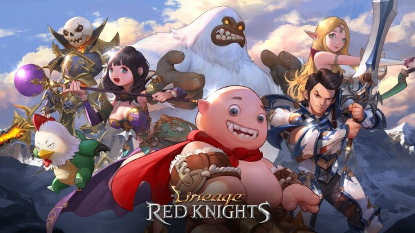

# ⚔️ 리니지 레드 나이츠

{ .cover }

!!! note ""
    모바일 수집형 RPG. CBT부터 서비스 오픈, 라이브 운영, 서비스 종료까지 서버 개발자로 참여했습니다.

## 개요

| 항목 | 내용 |
|---|---|
| 회사 | 엔씨소프트 |
| 기간 | 2016.08 – 2020.10 |
| 장르 / 플랫폼 | 수집형 RPG / 모바일 |
| 직책 | 서버 개발 (사원) |
| 참여 범위 | CBT → 서비스 오픈 → 라이브 운영 → 서비스 종료 |

## 담당 업무

- 게임 콘텐츠 개발 및 시스템 구현
- Jinja2를 이용한 백오피스 개발
- 인증, 결제, 푸시 메시지를 위한 사내 SDK 연동
- 일본 서비스 오픈 준비 작업

## 세부 내용

### 게임 핵심 시스템 개발

- 펫, 기간제 서비스, 버프, 마스터리, PvP 등 주요 컨텐츠 서버 로직 개발
- 실시간 처리 안정화 및 데이터 구조 개선

### DB 뷰어 및 웹툴 개발

- 운영과 QA가 활용하는 데이터 조회 및 관리용 웹툴 개발
- Flask, Jinja2 기반 UI와 기능 구현 및 유지보수

### BI 로그 설계 및 구축

- 게임 이용 패턴 분석을 위한 로그 이벤트 설계
- Fluentd 기반 로그 수집 파이프라인 구성 및 운영

### 외부 SDK 연동

- 인증, 결제, 푸시 메시지, 분석 등 사내 및 외부 SDK 연동
- 지역별 서비스 조건에 따른 커스터마이징 및 검증

### 일본 서비스 오픈 준비

- 서버 개발 언어 변경을 위한 프로토타입 개발 (Go, Java, C#)

## 개발 기술 및 툴

| 분야 | 기술 |
|---|---|
| 서버 | Python, Flask, Jinja2, Go (Echo, Gin), C# |
| 클라이언트 | Unity |
| 데이터 / 로그 | Couchbase, Fluentd |
| 환경 / 협업 | Linux, macOS, PyCharm, Jira, Git |
