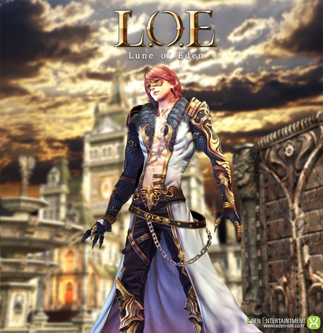

# 🏰 L.O.E

{ .cover }

!!! note ""
    논타겟팅 PC MMORPG. 개발 초기부터 FGT/CBT까지 서버 개발자로 참여했습니다.

## 개요

| 항목 | 내용 |
|---|---|
| 회사 | 에덴엔터테인먼트 |
| 기간 | 2011.06 – 2011.12 |
| 장르 / 플랫폼 | MMORPG (논타겟팅) / PC |
| 직책 | 서버 개발 (사원) |
| 참여 범위 | 개발 초기 → FGT/CBT |
| 아키텍처 유형 | MMO형 |

## 담당 업무

- 게임 컨텐츠 개발 (전투, 버프, 아이템, 퀘스트, PvP 서버 로직)
- 데이터베이스 설계 및 프로시저 구현, 쿼리 튜닝을 통한 성능 개선
- MFC를 이용한 백오피스 개발
- FGT, CBT 기간의 이슈 대응과 서버 튜닝

## 개발 기술 및 툴

C++, MFC, MS-SQL, Windows, Visual Studio, SVN
