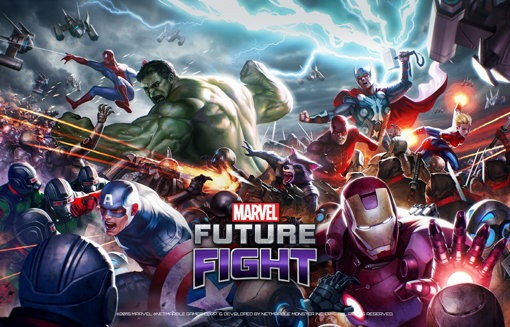

# 🦸 마블 퓨처 파이트

{ .cover }

!!! note ""
    글로벌 서비스 모바일 수집형 RPG. 프로토타입부터 글로벌 런칭과 라이브 운영까지 서버 개발자로 참여했습니다.

## 개요

| 항목 | 내용 |
|---|---|
| 회사 | 넷마블 몬스터 |
| 기간 | 2014.12 – 2016.06 |
| 장르 / 플랫폼 | 수집형 RPG / 모바일 |
| 직책 | 서버 개발 (사원) |
| 참여 범위 | 프로토타입 개발 → 글로벌 서비스 오픈 → 라이브 운영 |
| 아키텍처 유형 | 모바일 RPG (API형) |

## 서비스 인프라 구성

| 계층 | 구성 |
|---|---|
| 클라이언트 | Unity (모바일, 글로벌) |
| 인증 · 결제 | 외부 SDK 연동 |
| 웹 계층 | nginx |
| 게임 API 서버 | Java, Jetty |
| 채팅 서버 | C++ 독립형 채팅 서버 |
| 데이터 | MS-SQL, Redis |

- 글로벌 런칭에 맞춰 대규모 트래픽을 고려한 서버 구조 개선과 인프라 구축
- 채팅을 독립 서버로 분리해 트래픽 처리량과 안정성 확보

## 서비스 오픈에서 한 일

- 프로토타입 제작부터 글로벌 서비스 런칭까지 서버 개발 참여
- 런칭 대비 대규모 트래픽 대응 구조 개선과 서버 부하 특성에 맞춘 최적화
- 로그인, 결제 연동 검증과 결제 이상 케이스 대응
- 런칭 후 라이브 서비스 이슈 대응과 기능 고도화

## 담당 업무

- 게임 서버 설계 및 구현
- 게임 콘텐츠 개발 및 시스템 구현
- 로그인, 결제 시스템을 위한 외부 SDK 연동
- 라이브 서비스 이슈 대응

## 세부 내용

### 결제 시스템 연동 및 검증

- 로그인, 결제를 위한 외부 SDK 연동 및 검증 처리
- 결제 이상 케이스 대응 및 안정적인 처리 구조 구축

### 대규모 트래픽 대응과 안정성 강화

- 대규모 트래픽을 고려한 서버 구조 개선 및 인프라 구축
- 데이터 불일치 케이스 분석 및 검증 로직 강화
- 서버 부하 특성에 맞춘 구조 개선 및 최적화
- 라이브 서비스 이슈 대응

### C++ 기반 채팅 서버 개발

- 실시간 커뮤니케이션을 위한 독립형 채팅 서버 설계 및 구현
- 트래픽 처리량과 안정성을 고려한 구조 설계

### 핵심 게임 시스템 서버 개발

- 캐릭터, 아이템, PvP, 우편, 상점, 스테이지 등 주요 컨텐츠 로직 구현

## 개발 기술 및 툴

| 분야 | 기술 |
|---|---|
| 서버 | Java, Jetty, C++ |
| 클라이언트 | Unity |
| 데이터 / 인프라 | MS-SQL, Redis, nginx |
| 환경 / 협업 | Linux, Windows, Redmine, Git |
