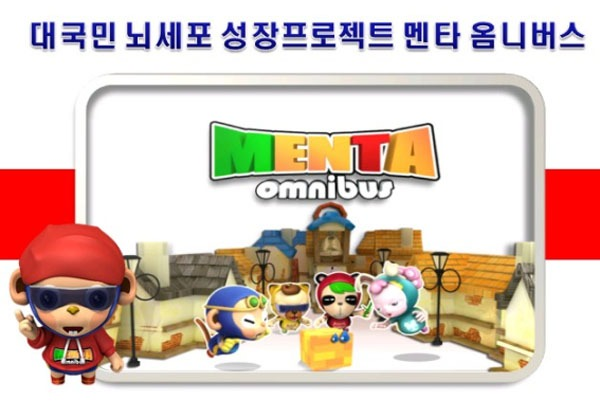

# 📚 Menta

{ .cover }

!!! note ""
    PC 교육용 기능성 게임. 개발 초기부터 FGT까지 서버 개발자로 참여했고, 네트워크 엔진을 RakNet에서 ProudNet으로 전환했습니다.

## 개요

| 항목 | 내용 |
|---|---|
| 회사 | 휴먼미디어테크 |
| 기간 | 2009.10 – 2010.11 |
| 장르 / 플랫폼 | 교육용 기능성 게임 / PC |
| 직책 | 서버 개발 (사원) |
| 참여 범위 | 개발 초기 → FGT |

## 담당 업무

- 게임 콘텐츠 개발 및 시스템 구현
- 서버 네트워크 엔진을 RakNet에서 ProudNet으로 전환 (패킷 구조 재정의, 세션·연결 관리 개선, 성능·안정성 검증)
- MFC를 이용한 백오피스 개발

## 개발 기술 및 툴

C++, MFC, RakNet, ProudNet, MS-SQL, Windows, SVN
