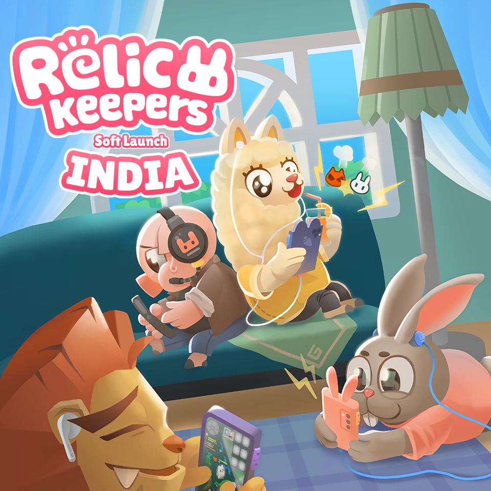

# 🗝️ Relic Keepers

{ .cover }

!!! note ""
    모바일 소셜 디덕션 게임. 프로토타입부터 서비스 오픈, 종료까지 서버 파트장으로 참여해 실시간 통신 구조와 로비 서버를 설계했습니다.

## 개요

| 항목 | 내용 |
|---|---|
| 회사 | 크래프톤 |
| 기간 | 2020.11 – 2022.06 |
| 장르 / 플랫폼 | 소셜 디덕션 / 모바일 |
| 직책 | 서버 파트장 |
| 참여 범위 | 프로토타입 개발 → 서비스 오픈 → 서비스 종료 |
| 아키텍처 유형 | 세션·매치형 |

## 서비스 인프라 구성

| 계층 | 구성 |
|---|---|
| 클라이언트 | Unity (모바일) |
| 인증 · 결제 | 자체 인증 + GamePot 연동 |
| 로비 서버 | C# SignalR (매칭, 친구, 메일) |
| 인게임 서버 | LiteNetLib 기반 실시간 통신 서버 |
| 데이터 | Aurora (MySQL), ElastiCache (Redis), S3 |
| 로그 | Fluentd → S3 BI 로그 파이프라인 |
| 배포 | Jenkins, Ansible, Slack 알림 |
| 운영 도구 | Blazor 백오피스 |

- 유저 세션, 게임 매치, 실시간 동기화 흐름을 기준으로 로비와 인게임 서버를 분리 설계
- AWS 인프라(EC2, Aurora, ElastiCache) 구축과 운영

## 서비스 오픈에서 한 일

- 프로토타입부터 서비스 오픈까지 서버 파트의 개발 일정과 기능별 우선순위 관리
- 결제, 분석, 광고 등 서비스 운영에 필요한 외부 SDK 연동과 안정화
- 오픈 전 BI 로그 설계와 로그 파이프라인, 빌드·배포 자동화 구축
- 오픈 후 라이브 운영과 서비스 종료까지 대응

## 담당 업무

- 게임 서버 설계 및 구현
- 게임 콘텐츠 개발 및 시스템 구현
- 팀 개발 일정 관리
- 로그인, 결제 시스템을 위한 GamePot 연동
- Fluentd, S3를 이용한 로그 파이프라인 구축
- Jenkins, Ansible을 통한 CI/CD 구축
- AWS를 이용한 서버 인프라 구축
- Blazor를 이용한 백오피스 개발

## 세부 내용

### 서버 구조 설계 및 구현

- 유저 세션, 게임 매치, 실시간 동기화 흐름 등 핵심 구조 설계
- 인게임을 위한 LiteNetLib 기반 실시간 통신 구조 구현 및 최적화
- SignalR 기반 로비 서버 구현 (매칭, 친구, 메일 등)

### 외부 SDK 연동

- 로그인, 결제를 위한 GamePot 연동
- 결제, 분석, 광고 등 서비스 운영에 필요한 SDK 연동 및 안정화, 이슈 분석 및 대응

### BI 로그 설계 및 구축

- 플레이 전반의 데이터 수집을 위한 BI 로그 설계
- Fluentd, S3를 사용한 로그 파이프라인 구성 및 운영

### 빌드, 배포 자동화와 인프라

- Jenkins, Ansible, Slack을 사용한 서버 빌드 및 배포 파이프라인 자동화
- AWS 인프라(EC2, Aurora DB, ElastiCache 등) 구축 및 운영
- Blazor를 이용한 백오피스 개발

### 팀 운영

- 팀 개발 일정 관리 및 기능별 우선순위 조정

### 계정 인증 및 컨텐츠 서버 로직

- 자체 인증 로직 구현 및 외부 인증 모듈 연동
- 게임 모드, 진행 로직, 보상 등 주요 컨텐츠 기능 구현

## 개발 기술 및 툴

| 분야 | 기술 |
|---|---|
| 서버 | C#, SignalR, LiteNetLib, protobuf, Java, Spring Boot |
| 클라이언트 | Unity |
| 백오피스 | Blazor, MudBlazor |
| 데이터 / 로그 | MySQL (Aurora), Redis (ElastiCache), S3, Fluentd |
| 인프라 / 배포 | AWS (EC2), Jenkins, Ansible |
| 환경 / 협업 | Linux, macOS, Jira, Confluence, Git |
