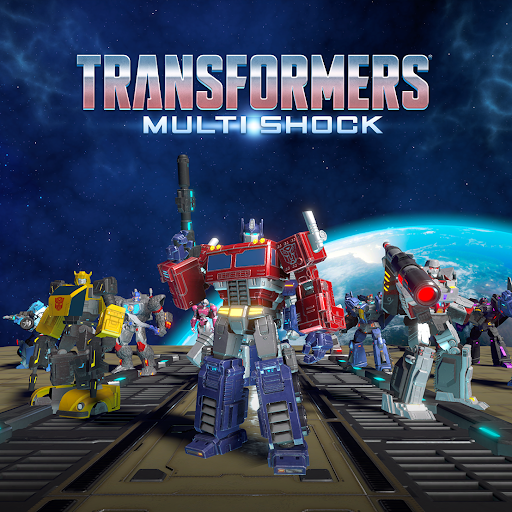

# 🤖 트랜스포머 멀티 쇼크

{ .cover }

!!! note ""
    모바일 로그라이크 RPG. 프로토타입 개발부터 일본 서비스 오픈, 라이브 운영까지 서버 팀장으로 참여했습니다.

## 개요

| 항목 | 내용 |
|---|---|
| 회사 | 에이시티게임즈 |
| 기간 | 2024.04 – 2025.11 |
| 장르 / 플랫폼 | 로그라이크 RPG / 모바일 |
| 직책 | 서버 팀장 |
| 참여 범위 | 프로토타입 개발 → 일본 서비스 오픈 → 라이브 서비스 운영 |
| 아키텍처 유형 | 모바일 RPG (API형) |

## 서비스 인프라 구성

| 계층 | 구성 |
|---|---|
| 클라이언트 | Unity (모바일) |
| 인증 · 결제 | 외부 플랫폼 연동 |
| 게임 서버 | C# MagicOnion 기반 서버 (AWS) |
| 데이터 | MySQL, Redis / Valkey, S3 |
| 배포 | Jenkins + Ansible CI/CD |
| 관측성 | Prometheus, Grafana, OpenTelemetry, Sentry |
| 데이터 분석 | BI 로그 → Looker Studio 통계 시각화 |
| 운영 도구 | Blazor 백오피스 |

- 프로토타입 단계부터 서버 구조와 함께 배포, 모니터링, 로그 체계를 설계해 오픈 이후 운영까지 고려
- 유닛 테스트로 코드 커버리지 80%를 유지해 라이브 중 변경 안정성 확보

## 서비스 오픈에서 한 일

- 프로토타입부터 일본 서비스 오픈까지 서버 팀의 개발 일정과 기능별 우선순위 관리
- 오픈 전 AWS 인프라, CI/CD, 모니터링 체계 구축
- 로그인, 결제를 위한 외부 플랫폼 연동
- Wiki를 구축해 유관 부서와의 협업 체계 정립
- 오픈 후 라이브 서비스 운영

## 담당 업무

- 게임 서버 설계 및 구현
- 게임 콘텐츠 개발 및 시스템 구현
- 팀 개발 일정 관리
- AWS를 이용한 서버 인프라 구축
- Jenkins, Ansible을 통한 CI/CD 구축
- 로그인, 결제 시스템을 위한 외부 플랫폼 연동
- Wiki 구축을 통한 유관 부서 협업 체계 정립
- Blazor를 이용한 백오피스 개발
- Prometheus, Grafana, Sentry를 이용한 모니터링 구축
- BI 로그 설계 및 구현, Looker Studio를 이용한 통계 시각화
- 유닛 테스트를 통한 코드 커버리지 80% 유지

## 세부 내용

### 서버 구조 설계

- 초기 서버 아키텍처 설계 및 핵심 모듈 구조화
- 안정성과 확장성을 고려한 서비스 기반 마련
- MagicOnion 기반 서버 프레임워크 구축

### 인프라 구축 및 운영

- AWS 기반 서버 환경 구성 (플로우 최적화, 모니터링, 배포)
- Jenkins, Ansible을 통한 CI/CD 구축
- Prometheus, Grafana, Sentry, OpenTelemetry를 이용한 모니터링 구축
- BI 로그 설계 및 구현, Looker Studio를 이용한 통계 시각화
- Blazor를 이용한 백오피스 개발

### 품질 관리와 팀 운영

- 유닛 테스트로 코드 커버리지 80% 유지
- 팀 내 개발 업무 분배, 우선순위 조정 및 진행 관리
- 개발 효율성과 코드 품질 향상을 위한 내부 가이드 정비
- Wiki 구축을 통한 유관 부서 협업 체계 정립

### 게임 컨텐츠 서버 로직

- 캐릭터, 아이템, 스테이지, 배틀 패스 등 주요 컨텐츠와 데이터 검증 구조 개발

## 개발 기술 및 툴

| 분야 | 기술 |
|---|---|
| 서버 | C#, MagicOnion, EF Core, AutoMapper, Dapper, MemoryPack, NUnit |
| 클라이언트 | Unity |
| 백오피스 | Blazor, MudBlazor |
| 데이터 | MySQL, Redis, Valkey, S3 |
| 인프라 / 배포 | AWS, Jenkins, Ansible |
| 모니터링 / 분석 | Prometheus, Grafana, OpenTelemetry, Sentry, Looker Studio |
| AI 도구 | Claude Code, GitHub Copilot, ChatGPT, Amazon Q |
| 환경 / 협업 | Linux, macOS, Jira, Confluence, Git |
